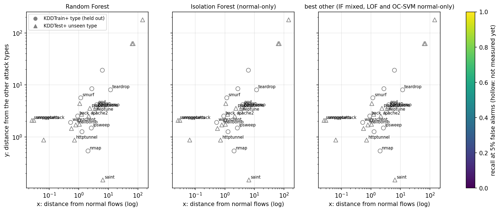

# Adaptive Threat Hunt


A research project on network intrusion detection under novelty, supervised by Dr. Pamela Thompson.
Every number below comes from a script in this repo and is stored in `results/`. [`RESULTS.md`](RESULTS.md)
has all tables with their source files, and [`paper/paper.pdf`](paper/paper.pdf) is a short write-up (LaTeX source in `paper/paper.tex`).

## Research question

When does a network intrusion detector catch an attack type it has never seen during training, and can we
tell in advance which new attacks it will miss?

I test three hypotheses:

- A supervised detector catches a new attack type when it resembles the types it was trained on.
- An anomaly detector catches a new attack type when it lies far from normal traffic.
- Types close to normal traffic and far from every known attack type are missed by both, at a reasonable
  false-alarm rate.

## Approach

Four detectors: Random Forest (uses labels), and Isolation Forest, LOF and One-Class SVM (no labels in
training). Models train on 80% of the training file. The other 20%, drawn again for each of 5 seeds, picks
each detector's alert threshold, and the threshold is then applied unchanged to the test set. The validation
split uses labels, only to choose the threshold. Detectors are compared at fixed false-alarm targets (1% and
5% on validation normal flows), not at a best-F1 threshold, and I report the false-alarm rate the same
threshold gives on the test set.

The main tool is a detection map. For each attack type, x is its distance from normal training flows and y
its distance from the other attack types (median over the type's flows of the mean distance to the 5 nearest
reference flows, feature space of the training split only). I plot recall against position and test whether
position predicts recall. Points come from a leave-one-attack-type-out study on the training file and, on
NSL-KDD, from the 17 attack types that appear only in the test file.

Two datasets: NSL-KDD (KDDTrain+ for training, KDDTest+ for testing) and CIC-IDS2017 with the corrected
labels, trained on Monday to Wednesday and tested on Thursday and Friday, where every attack type is new.

## What I found

On NSL-KDD, the forest recalls the most at each target but its threshold does not transfer: a 5% validation
target becomes a 12.6% false-alarm rate on KDDTest+. Normal-only Isolation Forest stays near target (2.2%)
and recalls less. Because the false-alarm rates differ, I cannot call either one better at equal false-alarm
rate on that file. The matched comparison is the leave-one-out study, where the forest leads on DoS, Probe
and U2R and ties with LOF on R2L.

Distance from normal traffic (x) is rank-correlated with recall for both detectors (Spearman 0.74 for the
forest and 0.62 for normal-only Isolation Forest over 30 types). Distance from other attack types (y) does
not predict forest recall in the direction the first hypothesis predicts. Neither position predicts the
recall of a single held-out type better than the mean of the other types. The blind-spot hypothesis is not
tested by these correlations; on CIC-IDS2017 the two types closest to normal traffic, botnet and SQL
injection, are missed by every unsupervised detector, but one of them has 13 test flows.

On CIC-IDS2017 the forest holds its 5% target (4.5%) and catches 98.7% of the new attacks. The anomaly
detectors depend strongly on the feature transform: raw Isolation Forest recalls 4% and the same detector
on sign(x) * log1p(|x|) features recalls 65%. I report both and do not pick by test results.

An earlier version of this README said Isolation Forest beat Random Forest. That number came from a threshold
tuned on test labels. With the same treatment for both models, the forest's F1 is 0.936 against 0.838.

### Recall at a validation false-alarm target (NSL-KDD, 5 seeds)

| Detector | Training | Target | Test false-alarm rate | Recall, all | Recall, seen | Recall, unseen |
|---|---|---|---|---|---|---|
| Isolation Forest | normal flows only | 1% | 0.007 | 0.540 | 0.595 | 0.407 |
| Isolation Forest | normal flows only | 5% | 0.022 | 0.638 | 0.644 | 0.622 |
| Isolation Forest | all training flows | 5% | 0.014 | 0.258 | 0.137 | 0.552 |
| Random Forest | labels | 1% | 0.064 | 0.818 | 0.852 | 0.737 |
| Random Forest | labels | 5% | 0.126 | 0.960 | 0.979 | 0.913 |
| One-Class SVM | normal flows only | 5% | 0.079 | 0.661 | 0.783 | 0.366 |
| Local Outlier Factor | normal flows only | 5% | 0.102 | 0.474 | 0.554 | 0.281 |

"Unseen" means the 17 attack types of KDDTest+ (3,750 flows) that never occur in KDDTrain+.

### Leave-one-attack-type-out (KDDTrain+, recall at a 5% target)

The test false-alarm rate is 0.041 to 0.051 for every model, so this comparison is matched.

| Held out | Random Forest | IF, normal only | OC-SVM, normal only | LOF, normal only |
|---|---|---|---|---|
| DoS (6 types) | 0.993 | 0.909 | 0.938 | 0.518 |
| Probe (4 types) | 0.966 | 0.542 | 0.761 | 0.733 |
| R2L (8 types) | 0.473 | 0.169 | 0.441 | 0.467 |
| U2R (4 types) | 0.931 | 0.235 | 0.669 | 0.550 |

These are not strict zero-day tests: related attack types can remain in training.

### Detection map



| Group (types) | x vs forest recall | x vs IF normal-only recall | y vs forest recall |
|---|---|---|---|
| All (30) | 0.74 [0.48, 0.89] | 0.62 [0.33, 0.84] | 0.41 [0.04, 0.70] |
| Held out (13) | 0.48 [-0.18, 0.87] | 0.37 [-0.25, 0.96] | 0.37 [-0.26, 0.83] |
| Unseen in KDDTest+ (17) | 0.76 [0.35, 0.94] | 0.68 [0.22, 0.91] | 0.31 [-0.20, 0.75] |

Spearman correlation with 95% bootstrap intervals over types. Leave-one-type-out prediction of recall from
(x, y) does not beat the mean of the other types (mean absolute error 0.17 against 0.17 for the forest, 0.33
against 0.30 for normal-only Isolation Forest). The x ranking is stable across neighbour counts but moves when
the categorical columns are one-hot encoded. In KDDTest+, 30 unseen attack flows are exact copies of a normal
training flow (28 snmpgetattack, one named, one snmpguess).

### CIC-IDS2017 (recall at the 5% target over all Thursday and Friday attacks, 5 seeds)

| Detector | Features | Test false-alarm rate | Recall |
|---|---|---|---|
| Random Forest | either | 0.045 | 0.987 |
| Isolation Forest, normal only | raw | 0.044 | 0.043 |
| Isolation Forest, normal only | slog1p | 0.050 | 0.648 |
| LOF, normal only | raw | 0.056 | 0.433 |
| LOF, normal only | slog1p | 0.062 | 0.974 |
| One-Class SVM, normal only | raw | 0.045 | 0.431 |
| One-Class SVM, normal only | slog1p | 0.049 | 0.974 |

Recall here is dominated by three types with 10,000 flows each. On the map of 14 types, x correlates with
normal-only Isolation Forest recall (Spearman 0.89 [0.60, 0.99] on raw features) and y does not predict
forest recall. The ranking of types on the map changes between the two feature spaces (Spearman 0.51).

### Other results

- A forest plus an anomaly detector sharing one 5% false-alarm budget shows no gain on the test set
  (`models/hybrid.py`).
- Label-free thresholds (quantiles of validation scores) do not target a false-alarm rate here, because
  validation is 47% attacks (`results/benchmark.json`).
- `models/pitfalls.py` measures how far common evaluation choices move the headline: a threshold chosen on
  test labels moves the forest's F1 from 0.796 to 0.936, and re-weighting precision from the test base rate
  to a 1% base rate moves it from 0.970 to 0.196.
- `models/feature_analysis.py` gives permutation importance on KDDTest+ for the forest and normal-only
  Isolation Forest, split by seen and unseen attacks. The importance is spread over groups of correlated
  features, so single bars are small (`results/feature_importance.json`).

## Limitations

- NSL-KDD derives from 1998 DARPA traffic, and its attacks are simulated. CIC-IDS2017 is one lab capture
  from 2017. Its test days differ from the training days by new attack types and by the day itself, and I
  cannot separate the two. Its web attack and infiltration types have 13 to 104 test flows.
- Thresholds use labels from a validation split. A label-free threshold that targets a false-alarm rate
  needs a validation set known to be benign, which I do not have. A matched comparison on the NSL-KDD test
  file is therefore missing.
- The map has 13 to 30 types, so its intervals are wide, and held-out types still have relatives in
  training. The pooled groups mix a matched and a drifted false-alarm rate.
- The anomaly detectors' results depend on the feature transform, and validation and test disagree about it.
- The capture pipeline (`sensors/capture.sh`, `feature_extractor/extract.py`, `models/train.py`,
  `models/score.py`) uses a different 9-feature set from both datasets, so the results say nothing about it.
  It was checked on a synthetic capture only, and `capture.sh` only with a stand-in for tcpdump.
- I tested the Windows setup below and a reduced run from a fresh clone. I did not test the macOS and Linux
  block or `scripts/run_all.sh` end to end.

## Setup

macOS or Linux:

```bash
git clone https://github.com/lucaaccomando/adaptive-threat-hunt.git
cd adaptive-threat-hunt
python3 -m venv .venv
source .venv/bin/activate
pip install -r requirements-dev.txt
python -m pytest -q
```

Windows (PowerShell):

```powershell
git clone https://github.com/lucaaccomando/adaptive-threat-hunt.git
cd adaptive-threat-hunt
python -m venv .venv
.venv\Scripts\activate
pip install -r requirements-dev.txt
python -m pytest -q
```

Python 3.12 is the stated version; CI also runs 3.13.

Reproduce the results:

```bash
python models/evaluate.py                    # default protocol, about 5 minutes
python models/evaluate.py --train-on normal  # unsupervised models trained on normal flows only
python models/leave_one_out.py               # about 1.5 hours
python models/detection_map.py
python models/hybrid.py
python models/pitfalls.py                    # reads the benchmark JSON files
python models/feature_analysis.py            # about 2 minutes
```

`bash scripts/run_all.sh` runs these in order, with the other benchmark variants (one-hot, log1p, tuned).
`--with-cic` adds the CIC-IDS2017 study, which is also available as `python models/cicids2017.py benchmark`,
`leave-one-out` and `map`, each with an optional `--transform slog1p`. The first call downloads 344 MB into
`data/cicids2017/` (sha256 checked, not tracked in git).

The NSL-KDD files are in `data/nslkdd/` (about 22 MB, tracked in git). Their sha256 is pinned in
`models/evaluate.py` and checked on load; missing files are downloaded.

`notebooks/analysis.ipynb` reads `results/*.json` and draws the maps; it trains nothing. To build the paper,
run `pdflatex paper.tex` twice inside `paper/` (needs a TeX installation); `paper.pdf` is the committed build.

## Repository layout

```
models/              detectors, benchmark, leave-one-out study, detection map, hybrid, pitfalls
feature_extractor/   pcap to flow features (experimental)
sensors/, attacks/   tcpdump capture script and lab attack simulations
tests/               pytest suite
results/             JSON outputs and figures
data/nslkdd/         NSL-KDD files
notebooks/           results walkthrough
paper/               LaTeX source of the short paper
```

## Acknowledgements

Research supervised by Dr. Pamela Thompson.

Datasets: NSL-KDD, University of New Brunswick, https://www.unb.ca/cic/datasets/nsl.html; CIC-IDS2017 with
the corrected labels of Engelen, Rimmer and Joosen.

## References

- Arp, Quiring, Pendlebury, Warnecke, Pierazzi, Wressnegger, Cavallaro, Rieck. Dos and Don'ts of Machine
  Learning in Computer Security. USENIX Security Symposium, 2022.
- Axelsson, S. The base-rate fallacy and its implications for the difficulty of intrusion detection. ACM
  Conference on Computer and Communications Security, 1999.
- Breiman, L. Random Forests. Machine Learning 45(1), 2001, pp. 5-32.
- Breunig, Kriegel, Ng, Sander. LOF: Identifying Density-Based Local Outliers. ACM SIGMOD, 2000, pp. 93-104.
- Engelen, Rimmer, Joosen. CICIDS2017 relabelling. IEEE Security and Privacy Workshops, 2021, pp. 7-12.
  DOI 10.1109/SPW53761.2021.00009.
- Liu, Ting, Zhou. Isolation Forest. IEEE International Conference on Data Mining, 2008, pp. 413-422.
- Schoelkopf, Platt, Shawe-Taylor, Smola, Williamson. Estimating the Support of a High-Dimensional
  Distribution. Neural Computation 13(7), 2001, pp. 1443-1471.
- Sommer, Paxson. Outside the Closed World: On Using Machine Learning for Network Intrusion Detection.
  IEEE Symposium on Security and Privacy, 2010. DOI 10.1109/SP.2010.25.
- Tavallaee, Bagheri, Lu, Ghorbani. A Detailed Analysis of the KDD CUP 99 Data Set. IEEE Symposium on
  Computational Intelligence for Security and Defense Applications, 2009, pp. 1-6.

## License

MIT License, copyright 2025 Luca Accomando
